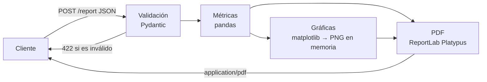

# json-to-pdf-report: Arquitectura

API HTTP que recibe un JSON con tickets de soporte y devuelve un **informe PDF** con métricas y gráficas.

## 1. Alcance

**Hace**
- Valida el JSON de entrada con un contrato estricto.
- Calcula métricas: totales, conteo por estado, prioridad y categoría, y tiempos de resolución.
- Genera 4 gráficas y las arma con una portada y tablas en un PDF.
- Devuelve el PDF en la respuesta (`application/pdf`).

**No hace** (a propósito)
- **No persiste nada**: no hay base de datos, cola ni almacenamiento. Cada petición es independiente.
- **No autentica.** Se pone detrás de un gateway o con IAM de Cloud Run si se despliega.
- **No genera PDFs asíncronos.** Para miles de tickets la respuesta tarda pocos segundos, así que una cola sería complejidad sin beneficio.

## 2. Vista general



El pipeline tiene **4 etapas**, cada una es una función pura en su propio módulo:

| Etapa | Entrada | Salida | Módulo |
|---|---|---|---|
| Validación | JSON | `ReportRequest` | `models.py` |
| Métricas | `ReportRequest` | `Metrics` (dataclass) + `DataFrame` | `metrics.py` |
| Gráficas | `DataFrame` | `list[ChartImage]` (PNG en `BytesIO`) | `charts.py` |
| PDF | `ReportRequest`, `Metrics`, gráficas | `bytes` | `pdf.py` |

`main.py` solo encadena las etapas. Así cada una se prueba sin levantar HTTP.

## 3. Contrato de la API

### `POST /report`

**Request**

```json
{
  "title": "Reporte de soporte",
  "period": { "start": "2026-01-01", "end": "2026-01-31" },
  "tickets": [
    {
      "id": "TCK-0001",
      "status": "resolved",
      "priority": "high",
      "category": "billing",
      "created_at": "2026-01-03T09:15:00Z",
      "resolved_at": "2026-01-03T14:40:00Z"
    }
  ]
}
```

| Campo | Tipo | Reglas |
|---|---|---|
| `title` | string | 1 a 120 caracteres |
| `period.start` / `period.end` | date | `start <= end`, máximo 366 días |
| `tickets` | array | 1 a 10 000 elementos |
| `tickets[].id` | string | 1 a 50 caracteres, único en la petición |
| `tickets[].status` | enum | `open`, `in_progress`, `resolved`, `closed` |
| `tickets[].priority` | enum | `low`, `medium`, `high`, `critical` |
| `tickets[].category` | string | 1 a 50 caracteres |
| `tickets[].created_at` | datetime | requerido; su día (UTC) debe caer dentro del periodo. Sin zona horaria se asume UTC |
| `tickets[].resolved_at` | datetime \| null | Si viene, `>= created_at`. Obligatorio si el estado es `resolved` o `closed` |

**Responses**

| Código | Cuándo | Cuerpo |
|---|---|---|
| `200` | OK | PDF con `Content-Disposition: attachment; filename="report.pdf"` |
| `422` | JSON inválido o reglas violadas | Error estándar de FastAPI |
| `413` | Cuerpo > 5 MB | `{"detail": "payload too large"}` |

### `GET /health`

`200 {"status": "ok"}`

No se expone Swagger ni `/openapi.json`; este documento es la referencia del contrato.

## 4. Contenido del PDF

1. **Portada**: título, periodo, fecha de generación y total de tickets.
2. **Resumen**: tabla de KPIs:
   - total
   - abiertos
   - resueltos
   - % resueltos
   - tiempo medio y mediano de resolución (horas)
   - P90 de resolución
3. **Gráficas**, una por sección:

   | Gráfica | Tipo | Datos |
   |---|---|---|
   | Tickets por estado | Barras | conteo por `status` |
   | Distribución del tiempo de resolución | Histograma | horas, solo tickets resueltos |
   | Tickets por categoría | Dona | conteo por `category`; top 6 y el resto como "Otras" |
   | Creados vs. resueltos por día | Línea | serie diaria dentro del periodo |

4. **Detalle por prioridad**: tabla con conteo y tiempo medio de resolución por `priority`.

Diseño visual: paleta neutra propia, tipografía Helvetica (base de ReportLab, sin archivos de fuentes), sin logos.

## 5. Decisiones técnicas

| Decisión | Motivo |
|---|---|
| **Contrato Pydantic, no `dict`** | Errores 422 claros, sin validación manual. |
| **Todo en memoria (`BytesIO`)**, sin archivos temporales | No hay limpieza que olvidar, no hay disco compartido entre peticiones y es compatible con contenedores de solo lectura. |
| **API orientada a objetos de matplotlib (`Figure`)**, no `pyplot` | `pyplot` guarda estado global y no es seguro entre hilos. `Figure()` es local a cada petición. Backend `Agg` (sin GUI). |
| **Endpoint `def` (síncrono), no `async def`** | El trabajo es de CPU. FastAPI corre los `def` en su threadpool y no bloquea el event loop. |
| **ReportLab Platypus** (`SimpleDocTemplate` + flowables) | Hace la paginación y el flujo de contenido sin calcular coordenadas a mano. |
| **Límite de 10 000 tickets y 5 MB** | Pone un tope a la memoria y el tiempo por petición. Si hace falta más, se pasa a un modo asíncrono (ver §9). |
| **Sin base de datos ni autenticación** | Fuera de alcance (§1). Se agregan cuando exista una necesidad real. |

## 6. Estructura del repo

```text
json-to-pdf-report/
├── app/
│   ├── main.py          # FastAPI: rutas y orquestación del pipeline
│   ├── models.py        # Contrato Pydantic (request)
│   ├── metrics.py       # DataFrame + KPIs
│   ├── charts.py        # 4 gráficas → PNG en memoria
│   └── pdf.py           # Armado del PDF
├── examples/
│   ├── sample.json      # Datos sintéticos (generados)
│   └── sample.pdf       # Salida de ejemplo para el README
├── scripts/
│   └── generate_sample.py   # Genera sample.json con semilla fija
├── tests/
│   └── test_report.py
├── docs/
│   └── screenshots/     # Capturas del PDF para el README
├── .github/workflows/ci.yml
├── Dockerfile
├── pyproject.toml
├── ARQUITECTURA.md
└── README.md
```

## 7. Stack

| Pieza | Elección |
|---|---|
| Lenguaje | Python 3.12 |
| API | FastAPI + Uvicorn |
| Datos | pandas |
| Gráficas | matplotlib (backend Agg) |
| PDF | ReportLab |
| Calidad | ruff (lint y formato), pytest |
| Paquetes | `pyproject.toml` (pip o uv) |
| Contenedor | `python:3.12-slim`, usuario sin privilegios |
| CI | GitHub Actions: ruff + pytest en cada push y PR |

## 8. Pruebas

Las pruebas son pocas pero cubren las partes que pueden romperse:

- **Feliz**: `POST /report` con `examples/sample.json` → `200`, el cuerpo empieza con `%PDF` y tiene ≥ 3 páginas.
- **Contrato**: estado `resolved` sin `resolved_at`, y `resolved_at < created_at` → `422`.
- **Métricas**: un caso pequeño calculado a mano (5 tickets) con KPIs exactos.

## 9. Extensiones futuras (solo si hacen falta)

- Modo asíncrono: `POST` → `202` con id, generación en Cloud Tasks y PDF en GCS. Aplica si se necesitan más de 10 000 tickets o generar en lote.
- Plantillas o temas de color por parámetro.
- Despliegue en Cloud Run privado con la autenticación de `cloudrun-private-auth` (otro repo del portafolio).

## 10. Plan de trabajo (1 a 2 días)

| # | Commit | Contenido |
|---|---|---|
| 1 | `chore: project skeleton` | `pyproject.toml`, estructura de carpetas, `/health` |
| 2 | `feat: request contract` | `models.py` + pruebas de contrato |
| 3 | `feat: synthetic data generator` | `scripts/generate_sample.py` + `examples/sample.json` |
| 4 | `feat: metrics` | `metrics.py` + prueba de métricas |
| 5 | `feat: charts` | `charts.py` |
| 6 | `feat: pdf assembly and /report endpoint` | `pdf.py`, `main.py` + prueba de punta a punta |
| 7 | `ci: lint and tests` | `ci.yml`, `Dockerfile` |
| 8 | `docs: readme with screenshots` | README, `sample.pdf`, capturas |
