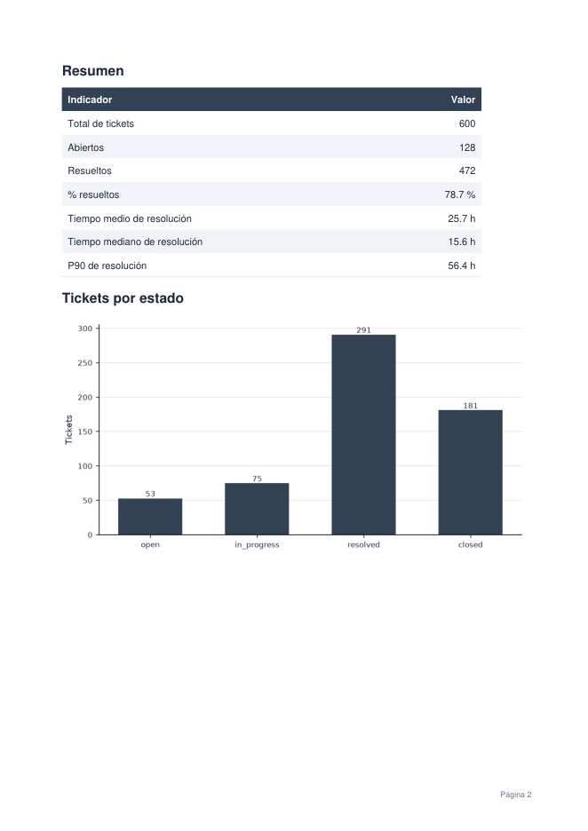
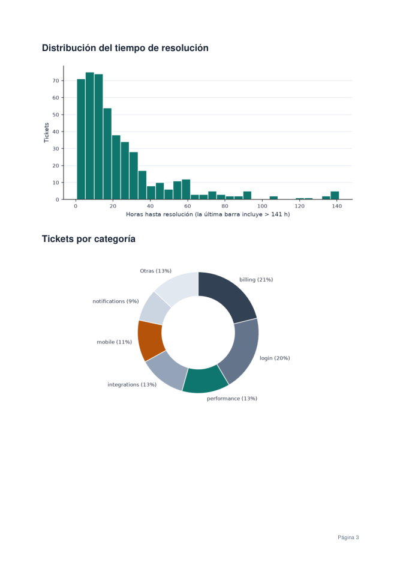
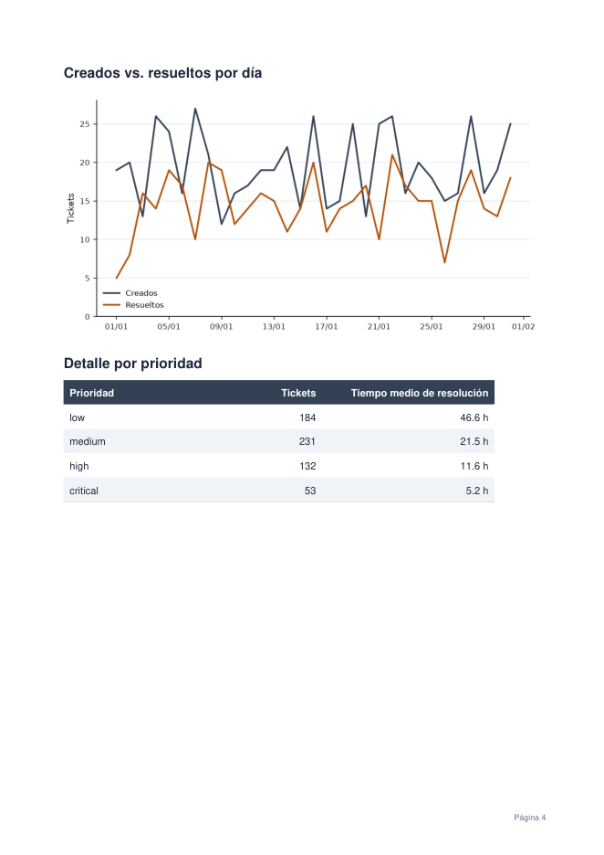

# json-to-pdf-report

API HTTP que recibe un JSON con tickets de soporte y devuelve un informe PDF con KPIs, cuatro gráficas y una tabla por prioridad.

Todo ocurre en memoria: sin base de datos, sin archivos temporales, sin estado entre peticiones. El diseño y sus motivos están en [ARQUITECTURA.md](ARQUITECTURA.md).

| Resumen | Gráficas | Detalle |
|---|---|---|
|  |  |  |

PDF completo de ejemplo: [examples/sample.pdf](examples/sample.pdf).

## Uso rápido

Requiere Python 3.12.

```bash
python -m venv .venv
source .venv/bin/activate        # Windows: .venv\Scripts\activate
pip install -e ".[dev]"
uvicorn app.main:app --reload
```

```bash
curl -X POST localhost:8000/report \
  -H "content-type: application/json" \
  --data-binary @examples/sample.json \
  -o report.pdf
```

### Con Docker

```bash
docker build -t json-to-pdf-report .
docker run --rm --read-only -p 8080:8080 json-to-pdf-report
```

El contenedor corre con un usuario sin privilegios y respeta `$PORT` (Cloud Run).

## API

### `POST /report`

```json
{
  "title": "Reporte de soporte",
  "period": { "start": "2026-01-01", "end": "2026-01-31" },
  "tickets": [
    {
      "id": "TCK-0001",
      "status": "resolved",
      "priority": "high",
      "category": "billing",
      "created_at": "2026-01-03T09:15:00Z",
      "resolved_at": "2026-01-03T14:40:00Z"
    }
  ]
}
```

- `status`: `open`, `in_progress`, `resolved`, `closed`.
- `priority`: `low`, `medium`, `high`, `critical`.
- `resolved_at` es obligatorio si el estado es `resolved` o `closed`, y no puede ser anterior a `created_at`.
- Entre 1 y 10 000 tickets por petición. Los campos no definidos en el contrato se rechazan.

| Código | Cuándo |
|---|---|
| `200` | PDF (`Content-Disposition: attachment; filename="report.pdf"`) |
| `422` | El JSON no cumple el contrato |
| `413` | El cuerpo pasa de 5 MB |

### `GET /health`

`{"status": "ok"}`

## Desarrollo

```bash
pytest -q
ruff check . && ruff format --check .
python scripts/generate_sample.py   # regenera examples/sample.json (semilla fija)
```

Las versiones están fijadas en `requirements.txt` y `requirements-dev.txt`. Tras cambiar
dependencias en `pyproject.toml`, regenéralas con `pip-tools`:

```bash
pip-compile --strip-extras -o requirements.txt pyproject.toml
pip-compile --strip-extras --extra dev -o requirements-dev.txt pyproject.toml
```

Como referencia, un informe de 10 000 tickets se genera en alrededor de un segundo en una laptop.

## Estructura

```text
app/
  main.py      rutas, límite de 5 MB y orquestación
  models.py    contrato Pydantic
  metrics.py   DataFrame y KPIs
  charts.py    4 gráficas (matplotlib, API de Figure, PNG en memoria)
  pdf.py       armado del PDF con ReportLab Platypus
scripts/generate_sample.py
tests/test_report.py
```
